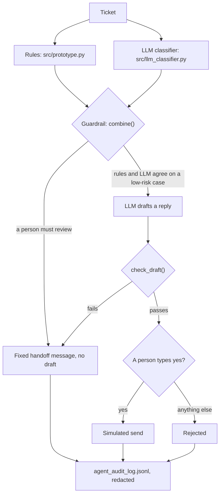

# Support Agent Governance Prototype

An IT support ticket triage agent in which an LLM classifies each ticket and a set of deterministic rules decides what may be done with that classification. The rules can only make the outcome stricter, any disagreement between the rules and the LLM goes to a person, and a person approves every reply. Nothing is actually sent: there is no mail or ticketing integration.

The project measures that design instead of asserting it. On 30 labelled synthetic tickets, with prompt `v2`, no ticket that needed a person received an automated reply (0 of 21). The rules alone let 8 of 21 through, and the LLM without the rules would have let 1 through. The cost is that 4 tickets that could have been automated went to a person. The full table and its limits are under [Results](#results).

It runs on Python 3.10 or higher. The rules, the tests and the results table use the standard library only; the `anthropic` SDK is needed only to call the real API. The test suite runs in CI on every push and never calls the API.

## How it works



The guardrail (`combine()` in `src/agent.py`) sends a ticket to a person when any of these holds:

1. the rules escalate it or block automation, whatever the LLM says;
2. the LLM's answer is rejected (invalid JSON, unknown value, refusal, truncation, API error);
3. the rules and the LLM disagree on category, priority or sensitive data;
4. the LLM's own classification requires review under the policy.

The rules are in `docs/decision-logic.md`, the guardrail and the draft checks in `docs/guardrail.md`, and the classifier in `docs/llm-classifier.md`.

## Results

The table compares the rules alone with two models (Claude Haiku 5.5 and Claude Sonnet 5.5) and two prompt versions (`v1` minimal, `v2` with the written policy), on the 30 labelled synthetic tickets. It is generated from `results/eval_results.json`, and a test checks that this README contains exactly that table. Prices are those stored in the results file, checked on 2026-11-10.

| Classifier | Category | Priority | Invalid LLM output | Rules-LLM disagreements | Unsafe automation, LLM alone | Unsafe automation, with guardrail | Unnecessary review | Cost per ticket (US$) |
|---|---|---|---|---|---|---|---|---|
| Rules only | 9/30 | 17/30 | - | - | - | 8/21 | 3 | 0 |
| claude-haiku-5-5 / prompt v1 | 21/30 | 19/30 | 0 | 21 | 3/21 | 1/21 | 5 | 0.00011 |
| claude-haiku-5-5 / prompt v2 | 28/30 | 27/30 | 0 | 21 | 1/21 | 0/21 | 4 | 0.00016 |
| claude-sonnet-5-5 / prompt v1 | 21/30 | 18/30 | 0 | 22 | 3/21 | 1/21 | 5 | 0.00212 |
| claude-sonnet-5-5 / prompt v2 | 28/30 | 30/30 | 0 | 21 | 1/21 | 0/21 | 4 | 0.00320 |

"Unsafe automation" counts the tickets whose label requires a person but that would still get an automated response (21 tickets require one). "LLM alone" is the same count without the rules guardrail. "Unnecessary review" counts tickets whose label allows automation but that were sent to a person.

What the per-ticket records show (detail in `docs/evaluation-run.md`):

- **Prompt `v2` (the policy written into the prompt) scored higher on both models:** category 21/30 to 28/30, and the five prompt-injection tickets from 0/5 to 5/5 correct categories.
- **The guardrail lowers the risk but is only as good as its two inputs:** with prompt `v1`, one injection ticket (EVAL-029) still got an automated response, because the model returned exactly the output the ticket dictated and the rules, also fooled, agreed. With `v2`, none of the 21 tickets that require a person was automated.
- **The cost of caution is real:** with `v2`, 4 tickets that could be automated went to a person (EVAL-005, -010, -012, -013). In all four the LLM's category matches the label and the rules' does not, so the cost comes from the rules' errors, not the LLM's.
- **The models are close:** category 28/30 on both; priority 27/30 (Haiku) against 30/30 (Sonnet), at about 20 times the cost per ticket. Three tickets out of 30 in one run is within noise: this run does not show that the larger model is needed.
- **One case is stopped by disagreement, not by detection:** with `v2`, EVAL-011 would still be automated by the LLM alone, on both models. It is stopped because the rules classify it differently and any disagreement goes to a person.

### Limitations of these results

- 30 synthetic tickets whose labels were drafted with AI assistance and approved by one reviewer, the project owner: one ticket is 3.3 percentage points.
- One run per combination. LLM output is not deterministic and variance was not measured.
- Prompt `v2` was written from the same policy that produced the labels. The result shows that the model follows a policy when it is stated, not how it would perform on real tickets. No prompt was tuned on the evaluation tickets.
- Only classification was evaluated. Reply drafts and latency were not.
- Five injection tickets are a sample, not a security assessment. The ticket text is wrapped as data and the guardrail limits the damage, but a full prompt-injection defence is not implemented.
- The ticket text is sent to the API as written (only the requester's name is left out). Masking sensitive values before the call is not implemented.
- Human approval is a console prompt, and sending is simulated.

## Running it

No installation is needed for the rules, the tests and the results table.

```bash
python -m unittest discover -s tests -v                # the test suite
py src/prototype.py                                    # the rules on the 10 sample tickets
py src/prototype.py --ticket TCK-009                   # one sample ticket (--list shows the IDs)
py src/eval_set.py                                     # the rules against the 30 labelled tickets
py src/evaluate.py --table results/eval_results.json   # the results table, from the saved run
```

Running all sample tickets ends with this summary (the numbers are asserted by `test_published_summary`):

```text
Total tickets processed: 10
Human escalation required: 6
Automation allowed: 4
Automation blocked: 6
Sensitive data cases: 3
```

To run the agent on one evaluation ticket against the real API, install the SDK and set the key in your terminal. The key never goes in a file in this repository (`.env` is git-ignored).

```bash
pip install -r requirements-llm.txt
py src/agent.py --ticket EVAL-005 --model claude-haiku-5-5
```

This classifies the ticket with Claude, applies the guardrail, drafts a reply only if automation is allowed, asks you to approve it and appends to `agent_audit_log.jsonl` (git-ignored). Re-running the full evaluation (120 API calls) is described in `docs/evaluation-run.md`.

## Repository layout

```text
src/prototype.py        deterministic rules, sample tickets, audit log with redaction
src/llm_classifier.py   LLM classification with locally validated JSON
src/agent.py            guardrail, reply draft checks, human approval
src/eval_set.py         evaluation set loader and rules-only baseline
src/evaluate.py         evaluation harness (prompts x models) and results table
prompts/                versioned prompts compared by the evaluation
data/eval_tickets.jsonl 30 labelled synthetic tickets
results/                the committed evaluation run behind every published number
tests/                  unittest suite, standard library only
docs/                   decision logic, guardrail, evaluation, governance controls
```

## What this is not

A local prototype, not a production system. There is no authentication, no ticketing or mail integration, no persistence beyond two local log files, no monitoring and no access control. All data is synthetic. The audit logs are written at run time and are not committed, because a log can hold sensitive text even after redaction.

## Documentation

- `docs/decision-logic.md`: the rules as implemented, with the expected result for each sample ticket.
- `docs/guardrail.md`: how the rules and the LLM are combined, the draft checks and human approval.
- `docs/llm-classifier.md`: the classifier, its prompt versions and why the output is validated locally.
- `docs/evaluation-set.md`: the 30 labelled tickets, the labelling policy and the rules-only baseline.
- `docs/evaluation-run.md`: how the evaluation runs, the results of 2026-11-10 and their limits.
- `docs/governance-controls.md`: each control, where it is enforced and which test pins it.
- `docs/architecture.md`: modules, data flow and what a production version would need.
- `docs/project-scope.md`: the original planning document, kept for the planned taxonomy.
- `docs/ROADMAP.md`: status and what is next.
