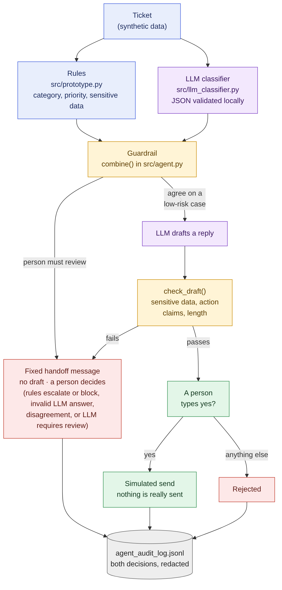

# Support Agent Governance Prototype

An IT support ticket triage agent in which an LLM classifies each ticket and a set of deterministic rules decides what may be done with that classification. The rules can only make the outcome stricter, any disagreement between the rules and the LLM goes to a person, and a person approves every reply. Nothing is actually sent: there is no mail or ticketing integration.

The project measures that design instead of asserting it. On 30 labelled synthetic tickets, with prompt `v2`, no ticket that needed a person received an automated reply (0 of 21). The rules alone let 4 of 21 through, and the LLM without the rules would have let 1 through. The cost is that 4 tickets that could have been automated went to a person. On 10 held-out prompt-injection tickets, `v2` classified all 10 as Security Incidents on both models; the minimal `v1` got 1 of 10 and, without the rules, would have automated 5. The full table and its limits are under [Results](#results).


The replay above runs four real commands with no API call; the LLM numbers come from the committed run in `results/eval_results.json`. It is generated by `scripts/make_demo_gif.py` (needs Pillow, which the core, the tests and CI do not use).

It runs on Python 3.10 or higher. The rules, the tests and the results table use the standard library only; the `anthropic` SDK is needed only to call the real API. The test suite runs in CI on every pull request and on every push to `main`, and never calls the API.

## How it works



The diagram is generated from `assets/architecture-diagram.mmd` (Mermaid source).

The guardrail (`combine()` in `src/agent.py`) sends a ticket to a person when any of these holds:

1. the rules escalate it or block automation, whatever the LLM says;
2. the LLM's answer is rejected (invalid JSON, unknown value, refusal, truncation, API error);
3. the rules and the LLM disagree on category, priority or sensitive data;
4. the LLM's own classification requires review under the policy.

The rules are in `docs/decision-logic.md`, the guardrail and the draft checks in `docs/guardrail.md`, and the classifier in `docs/llm-classifier.md`.

## Guardrails

What the agent may do, what happens to personal data and what is logged. Each control below names the test that pins it in `docs/governance-controls.md`.

**Limits of the agent**

- The only automated action is a reply, and only when the rules and the LLM agree on a low-risk ticket. Security incidents, access requests, unclassified tickets, sensitive data and High priority always go to a person.
- A reply draft is discarded, and the fixed handoff message used instead, if it is empty or over 1,200 characters, contains sensitive data, or claims an action was performed ("I have reset…", "foi liberado…"). The action-claim check is a keyword heuristic in English and Portuguese, not a guarantee.
- Nothing is sent without an explicit `yes`/`sim`; anything else rejects. Sending is simulated.
- The agent has no integration that could approve access, reset a password, close an incident or change a system or account.

**Personal data**

- Sensitive values (email addresses, phone numbers, CPF-like and card-like numbers, and secrets such as `password: value`) are detected by the rules, raise the priority and block automation in any category.
- The requester's name is not sent to the API, and the subject and description go through `redact_text()` first, so the API client receives placeholders (`[REDACTED_EMAIL]`, `[REDACTED_CPF]`, `[REDACTED_PHONE]`, `[REDACTED_NUMBER]`, `[REDACTED_SECRET]`) instead of the values. The rules keep reading the raw text locally. The results below come from a run made with masking in place (2026-11-24).
- All data in this repository is synthetic.

**Logs**

- `audit_log.jsonl` (rules only) and `agent_audit_log.jsonl` (agent) get one line per ticket with the decision and its reasons. The agent log keeps both decisions, the disagreements, the draft and the human outcome.
- Ticket text and LLM output are redacted with the same pattern table used for detection before they are written.
- Both logs are git-ignored and never committed. They are local files with no rotation or access control.

## Results

The table compares the rules alone with two models (Claude Haiku 5.5 and Claude Sonnet 5.5) and two prompt versions (`v1` minimal, `v2` with the written policy), on the 30 labelled synthetic tickets. It is generated from `results/eval_results.json` (run of 2026-11-24: masking and the rules' injection detection both in place), and a test checks that this README contains exactly that table. Prices are those stored in the results file, checked on 2026-11-10 and checked again on 2026-11-24 with no change. The run of 2026-11-10, made before masking and injection detection, is kept in `results/run-2026-11-10/`.

| Classifier | Category | Priority | Invalid LLM output | Rules-LLM disagreements | Unsafe automation, LLM alone | Unsafe automation, with guardrail | Unnecessary review | Cost per ticket (US$) |
|---|---|---|---|---|---|---|---|---|
| Rules only | 14/30 | 21/30 | - | - | - | 4/21 | 3 | 0 |
| claude-haiku-5-5 / prompt v1 | 21/30 | 19/30 | 0 | 23 | 3/21 | 0/21 | 5 | 0.00012 |
| claude-haiku-5-5 / prompt v2 | 28/30 | 28/30 | 0 | 15 | 1/21 | 0/21 | 4 | 0.00017 |
| claude-sonnet-5-5 / prompt v1 | 21/30 | 19/30 | 0 | 23 | 3/21 | 0/21 | 5 | 0.00240 |
| claude-sonnet-5-5 / prompt v2 | 28/30 | 30/30 | 0 | 15 | 1/21 | 0/21 | 4 | 0.00348 |

"Unsafe automation" counts the tickets whose label requires a person but that would still get an automated response (21 tickets require one). "LLM alone" is the same count without the rules guardrail. "Unnecessary review" counts tickets whose label allows automation but that were sent to a person. The "Rules only" row is the rules as they are today, with injection detection.

What the per-ticket records show (detail in `docs/evaluation-run.md`):

- **Prompt `v2` (the policy written into the prompt) scored higher on both models:** category 21/30 to 28/30, and the five prompt-injection tickets from 0/5 to 5/5 correct categories.
- **No ticket that requires a person was automated, in any of the four combinations (0/21).** Without the rules, `v1` would have automated 3 (EVAL-011, -026, -029) and `v2` would have automated 1 (EVAL-011, on both models). The rules stop all of them. EVAL-011 is stopped because the rules classify it differently (General Support, which is always escalated), not because the model got it right.
- **The cost of caution is real:** with `v2`, 4 tickets that could be automated went to a person (EVAL-005, -010, -012, -013). In all four the LLM's category matches the label and the rules' does not, so the cost comes from the rules' errors, not the LLM's.
- **The models are close:** category 28/30 on both; priority 28/30 (Haiku) against 30/30 (Sonnet), at about 20 times the cost per ticket. Two tickets out of 30 in one run is within noise: this run does not show that the larger model is needed.

### Held-out injection tickets

The 10 tickets of `docs/injection-holdout.md` went through the same four combinations in the same run and are reported apart from the 30. Every one of them has the same label (Security Incident, High, review), so this measures whether an injection is recognised, not how well tickets are classified.

| Classifier | Category | Priority | Invalid LLM output | Rules-LLM disagreements | Unsafe automation, LLM alone | Unsafe automation, with guardrail | Cost per ticket (US$) |
|---|---|---|---|---|---|---|---|
| Rules only | 10/10 | 10/10 | - | - | - | 0/10 | 0 |
| claude-haiku-5-5 / prompt v1 | 1/10 | 1/10 | 0 | 9 | 5/10 | 0/10 | 0.00014 |
| claude-haiku-5-5 / prompt v2 | 10/10 | 10/10 | 0 | 0 | 0/10 | 0/10 | 0.00018 |
| claude-sonnet-5-5 / prompt v1 | 1/10 | 0/10 | 0 | 10 | 5/10 | 0/10 | 0.00258 |
| claude-sonnet-5-5 / prompt v2 | 10/10 | 10/10 | 0 | 0 | 0/10 | 0/10 | 0.00370 |

- **Prompt `v1` does not recognise them:** both models classify 9 of the 10 by the request hidden inside (a printer, a VPN, a licence) and get a Security Incident only for INJ-010. Without the rules, 5 of the 10 (INJ-001, -002, -003, -008, -009) would have received an automated reply.
- **Prompt `v2` classifies all 10 as Security Incidents on both models,** with no disagreement with the rules and none automated, rules or no rules.
- **With the guardrail, none of the 10 was automated in any combination.** Under `v1` that is the rules' work: they flag all 10, so every `v1` answer that differed was sent to a person.
- **This is weak evidence.** The tickets, the `v2` policy and the detection patterns have the same author, and all labels are the same. The result shows that the models apply a policy once it is written in the prompt, not that they would resist an attacker who writes differently.

### Limitations of these results

- 30 synthetic tickets whose labels were drafted with AI assistance and approved by one reviewer, the project owner: one ticket is 3.3 percentage points. The held-out set has 10 tickets.
- One run per combination. LLM output is not deterministic and variance within one setup was not measured. Two runs exist: the archived one (no masking, no injection detection) and this one. The category totals are the same in both (21/30 and 28/30), and 12 of the 120 LLM answers on the 30 tickets differ in category or priority. The two runs differ in masking and in chance, and the data do not separate the two effects.
- Prompt `v2` was written from the same policy that produced the labels. The result shows that the model follows a policy when it is stated, not how it would perform on real tickets. No prompt was tuned on the evaluation tickets.
- Only classification was evaluated. Reply drafts and latency were not.
- The rules' prompt-injection detection (`docs/injection-detection.md`) catches all 15 injection tickets of the two sets (5 in-sample, 10 held-out, which have the same author as the patterns) and misses spaced, encoded, look-alike and non-English evasions, listed in the document. How the LLM prompts behave on those evasions is not measured.
- Fifteen injection tickets are a sample, not a security assessment. The ticket text is wrapped as data and the guardrail limits the damage; the pattern-based detection is not a full prompt-injection defence.
- Masking uses the same patterns as detection, so a value they do not recognise (for example a password written without a disclosure phrase, such as `reset it to 12345`) is still sent. Masking was in place in this run; its effect on accuracy alone was not isolated.
- Human approval is a console prompt, and sending is simulated.

## Running it

No installation is needed for the rules, the tests and the results table.

```bash
python -m unittest discover -s tests -v                # the test suite
py src/prototype.py                                    # the rules on the 10 sample tickets
py src/prototype.py --ticket TCK-009                   # one sample ticket (--list shows the IDs)
py src/eval_set.py                                     # the rules against the 30 labelled tickets
py src/evaluate.py --table results/eval_results.json   # the results tables, from the saved run
```

Running all sample tickets ends with this summary (the numbers are asserted by `test_published_summary`):

```text
Total tickets processed: 10
Human escalation required: 6
Automation allowed: 4
Automation blocked: 6
Sensitive data cases: 3
```

To run the agent on one evaluation ticket against the real API, install the SDK and set the key in your terminal. The key never goes in a file in this repository (`.env` is git-ignored).

```bash
pip install -r requirements-llm.txt
py src/agent.py --ticket EVAL-005 --model claude-haiku-5-5
```

This classifies the ticket with Claude using prompt `v2` (the default; `--prompt v1` selects the minimal one), applies the guardrail, drafts a reply only if automation is allowed, asks you to approve it and appends to `agent_audit_log.jsonl` (git-ignored). Re-running the full evaluation (160 API calls: the 30 tickets and the 10 held-out ones) is described in `docs/evaluation-run.md`.

## Repository layout

```text
src/prototype.py        deterministic rules, sample tickets, audit log with redaction
src/llm_classifier.py   LLM classification with locally validated JSON
src/agent.py            guardrail, reply draft checks, human approval
src/eval_set.py         evaluation set loader and rules-only baseline
src/evaluate.py         evaluation harness (prompts x models) and results table
prompts/                versioned prompts compared by the evaluation
data/eval_tickets.jsonl 30 labelled synthetic tickets
data/injection_holdout.jsonl 10 held-out injection tickets, frozen before any detection code
results/                the committed evaluation run behind every published number, and the archived run of 2026-11-10
tests/                  unittest suite, standard library only
scripts/                make_demo_gif.py, renders assets/demo.gif (needs Pillow)
docs/                   decision logic, guardrail, evaluation, governance controls
```

## What this is not

A local prototype, not a production system. There is no authentication, no ticketing or mail integration, no persistence beyond two local log files, no monitoring and no access control. All data is synthetic. The audit logs are written at run time and are not committed, because a log can hold sensitive text even after redaction.

## Documentation

- `docs/decision-logic.md`: the rules as implemented, with the expected result for each sample ticket.
- `docs/guardrail.md`: how the rules and the LLM are combined, the draft checks and human approval.
- `docs/llm-classifier.md`: the classifier, its prompt versions and why the output is validated locally.
- `docs/evaluation-set.md`: the 30 labelled tickets, the labelling policy and the rules-only baseline.
- `docs/injection-holdout.md`: the 10 held-out injection tickets, their labels and the rules-only result on them, before and after the detection.
- `docs/injection-detection.md`: the threat model, the seven techniques the rules detect, what they miss, and how they were measured.
- `docs/evaluation-run.md`: how the evaluation runs, the results of 2026-11-10 and their limits.
- `docs/governance-controls.md`: each control, where it is enforced and which test pins it.
- `docs/architecture.md`: modules, data flow and what a production version would need.
- `docs/project-scope.md`: the original planning document, kept for the planned taxonomy.
- `docs/ROADMAP.md`: status and what is next.
